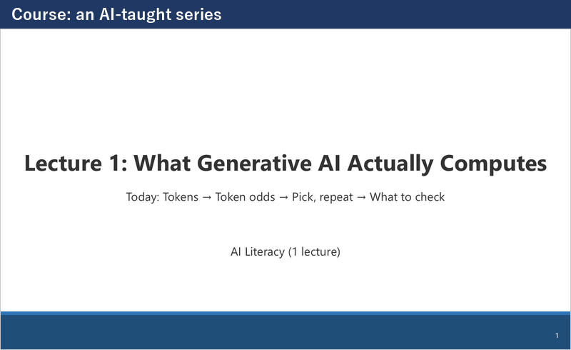
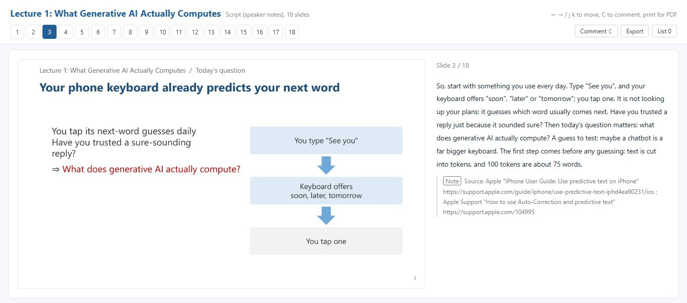
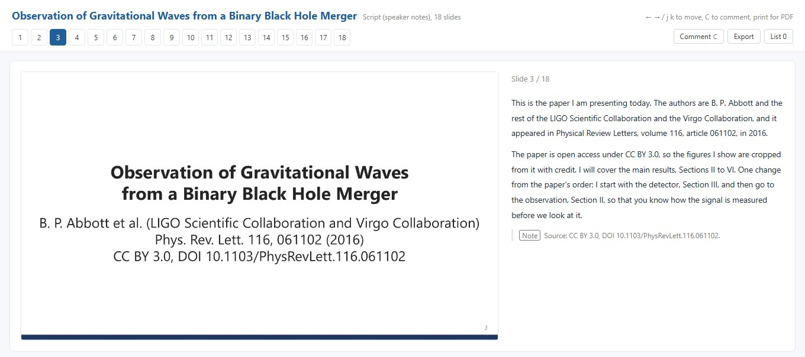
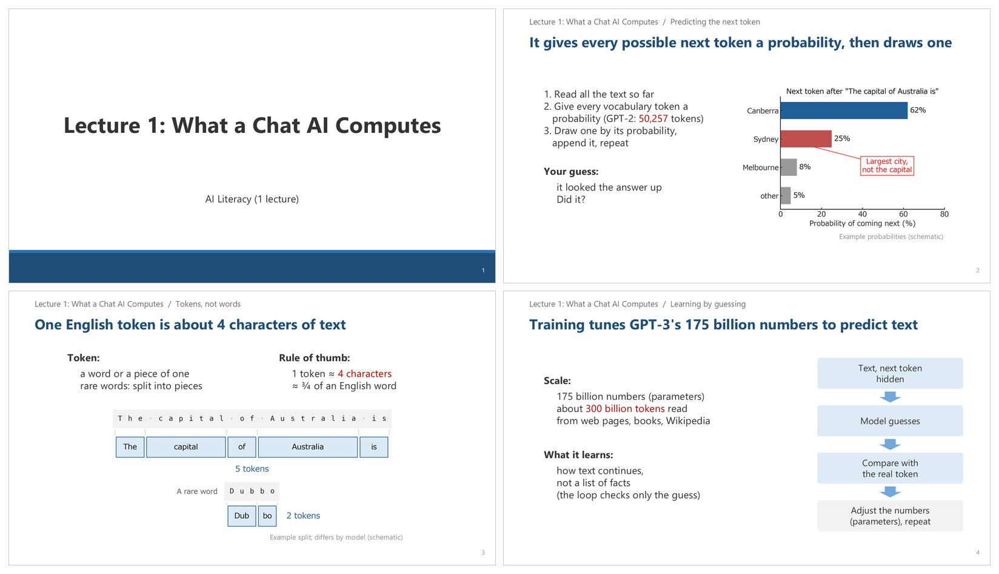
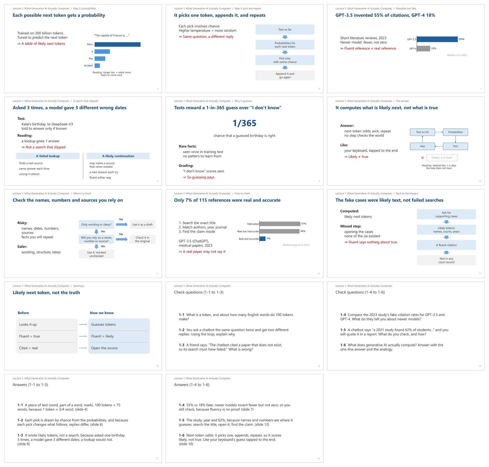
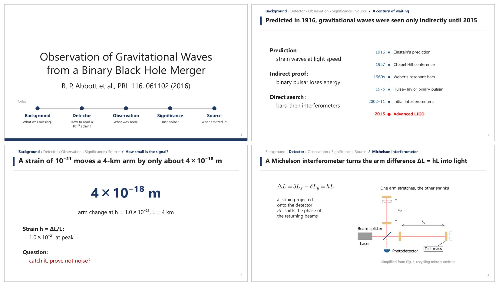
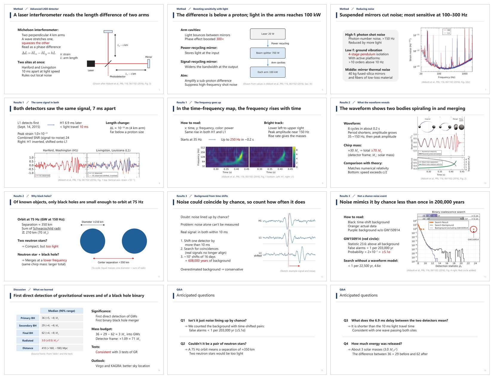

[English](README.md) | [日本語](README.ja.md)

# sensei-slides

**An agent skill that makes lecture and seminar slides people can actually follow: an AI-taught course built one session at a time, or a single talk from a paper or textbook.**

Version 0.9.0 (2026-11-22). **[Download the latest release](https://github.com/naito-kanato/sensei-slides/releases/latest/download/sensei-slides.zip)** (a ready-to-use work folder with the skill inside). Changes: [CHANGELOG.md](CHANGELOG.md) (in Japanese).

> **The instructions and check messages are in Japanese; the slides can be in another language.** Ask in English (or another language) and the slides, speaker notes, quiz and script page are made in the language of your request (you can also name a language), while the plans and the agents' instructions stay in Japanese. The checks count text by display width, so the same targets work for English. The samples on this page were made by asking in English ([examples/course_en](examples/course_en), [examples/zemi_en](examples/zemi_en)).

You ask an AI coding agent (Codex, Claude Code; Antigravity and GitHub Copilot can read it too), and it produces a **PowerPoint deck (.pptx), a read-aloud script, and an HTML page** that shows each slide next to its script, where you leave comments and answer quiz questions.

| Course | Talk |
|---|---|
| From a topic or a PDF, the AI plans an N-session course and builds one session at a time. It reads your quiz answers and comments, then adjusts the next session. | One deck from a paper, a textbook section, your own figures, or earlier slides: lab seminars, conference talks, or a "solo seminar" to understand a paper yourself. |
|  |  |
| Sample: AI literacy course, lecture 1, "What a Chat AI Computes" (16 slides) | Sample: paper review, "The First Observation of Gravitational Waves" (Abbott et al., PRL 2016, CC BY 3.0; 17 slides) |

The samples were not picked for quality: we chose a topic, asked once in English, and show what the skill made (we then fixed only what later checks catch: in the talk, one paper figure too small to read, three "my estimate" notes on slides and one step not in the same form as the others; in the lecture, one list item not in the same form. After adding new slide types, we also used them where a check found six slides of the same type in a row, and added figures to the expected questions). The same topics made in Japanese are in [examples/course](examples/course) and [examples/zemi](examples/zemi).

**Course sample** (slides 1–4)

<b>All remaining slides (5–16)</b>

**Talk sample** (slides 1–4)

<b>All remaining slides (5–17)</b>

## Design principles

AI-made slides often look tidy but leave gaps that only the AI can fill. The skill is built on five principles, each checked before and after the deck is built.

1. **Inference distance: find where the listener gets stuck.** The plan is read as the listener (by a separate agent with the lightness option set to "careful"; by default, the writer avoids the same gap types from the start), writing out every premise the listener would have to supply. Each one is then fixed inside the flow (an earlier mention, a one-line aside, a sentence in the script), at a level set by how much the listener already knows.
2. **Beats: order by question and answer, not by the source.** Situation → complication → question → answer. You pick one of 13 story patterns, and the answer comes first (talks, pyramid style) or last (courses). Each slide states its conclusion, and the steps from slide to slide (and so / but / therefore) are checked.
3. **Catch the writer's blind spots with checks (and, if you choose, a separate reviewer).** By default (lightness "standard"), two agents make the deck (design and build), a small separate agent audits only the inference distance in between (principle 1), and scripts check the spots writers miss every time: no question to hook the audience early, the same data on two slides, unchecked facts, too much text. Each agent gets rules only where it stumbles every time; the rest is left to the model. With "careful", the plan and the finished deck are also reviewed by an agent in a separate conversation, fixes go to a new agent, and it costs about three times as many tokens. In a blind comparison, the two settings scored about the same.
4. **Look for numbers before choosing the storyline.** The design agent (a separate agent with "careful") first looks for pairs of comparable numbers and clear surprising facts that break a common assumption; these become the "but" of the story. "Nothing found" is a valid result, so numbers are never forced. Each number carries its source, date, denominator, and one reading under which it would not be surprising.
5. **Do not strengthen qualifiers.** In a multi-step pipeline, a source's "is considered" can grow into "is required" by the time it reaches a slide. If a checked fact has a qualifier and the slide that uses it does not, the check flags it.

### Form and amount

- **How text is laid out.** You choose a body form for each slide (cause → effect, labels, cases, steps, a question and its result…). Each form has fixed slots, and the facts go into those slots. Figures are chosen by purpose first (compare, trend, breakdown, mechanism…), then by kind.
- **Amount and emphasis, checked on the rendered slides.** Overflow, overlaps, characters per slide and per line, and the gap between text and figures are measured on the rendered slides (the layout is computed from the .pptx the way PowerPoint lays it out; when PowerPoint is installed, the finished round is also rendered in PowerPoint to confirm). A deck is not called done until the final check passes.

## Quick start

1. Download the zip above and unzip it.
2. Open the folder in your agent (in Codex, mark it as trusted).
3. Ask, for example "Make slides from paper.pdf" or "Make a course on …". The deck is made in the language you ask in (「〇〇.pdf のスライドを作って」 gives a Japanese deck). Before it starts, the agent posts the settings and says which language it will use.

The agent first checks Python (3.10+), whether PowerPoint is installed (optional) and Japanese fonts. It asks before installing missing packages into a local `.venv`.
Full instructions are in the Japanese README ([README.ja.md](README.ja.md)) and in `how_to_use.html` inside the zip (switch it to English with the button at the top right).

## License

[MIT](LICENSE). The talk example uses figures from Abbott et al., *Phys. Rev. Lett.* **116**, 061102 (2016), CC BY 3.0, with attribution (`examples/zemi/paper_figs/ATTRIBUTION.md`).
