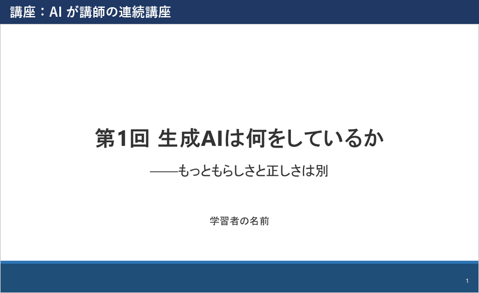

[English](README.md) | [日本語](README.ja.md)

# sensei-slides

**An agent skill that makes lecture and seminar slides people can actually follow: an AI-taught course built one session at a time, or a single talk from a paper or textbook.**

Version 0.7.0 (2026-11-12). **[Download the latest release](https://github.com/naito-kanato/sensei-slides/releases/latest/download/sensei-slides.zip)** (a ready-to-use work folder with the skill inside). Changes: [CHANGELOG.md](CHANGELOG.md) (in Japanese).

> **The slides, speaker notes, instructions and check messages are in Japanese.** This skill is built for Japanese-language decks. English output is not supported yet.

You ask an AI coding agent (Codex, Claude Code; Antigravity and GitHub Copilot can read it too), and it produces a **PowerPoint deck (.pptx), a read-aloud script, and an HTML page** that shows each slide next to its script, where you leave comments and answer quiz questions.

| Course | Talk |
|---|---|
| From a topic or a PDF, the AI plans an N-session course and builds one session at a time. It reads your quiz answers and comments, then adjusts the next session. | One deck from a paper, a textbook section, your own figures, or earlier slides: lab seminars, conference talks, or a "solo seminar" to understand a paper yourself. |
|  |  |

## Design principles

AI-made slides often look tidy but leave gaps that only the AI can fill. The skill is built on five principles, each checked before and after the deck is built.

1. **Inference distance: find where the listener gets stuck.** A separate agent reads the plan as the listener and writes out every premise the listener would have to supply. Each one is then fixed inside the flow (an earlier mention, a one-line aside, a sentence in the script), at a level set by how much the listener already knows.
2. **Beats: order by question and answer, not by the source.** Situation → complication → question → answer. You pick one of 13 story patterns, and the answer comes first (talks, pyramid style) or last (courses). Each slide states its conclusion, and the steps from slide to slide (and so / but / therefore) are checked.
3. **The writer never reviews its own work.** The plan and the finished deck are reviewed by an agent in a separate conversation, and fixes after a review go to a new agent too. The reviewer applies a fixed list of finding types to every slide, so results depend less on the model.
4. **Look for numbers before choosing the storyline.** A separate agent first looks for pairs of comparable numbers and clear surprising facts that break a common assumption; these become the "but" of the story. "Nothing found" is a valid result, so numbers are never forced. Each number carries its source, date, denominator, and one reading under which it would not be surprising.
5. **Do not strengthen qualifiers.** In a multi-step pipeline, a source's "is considered" can grow into "is required" by the time it reaches a slide. If a checked fact has a qualifier and the slide that uses it does not, the check flags it.

### Form and amount

- **How text is laid out.** You choose a body form for each slide (cause → effect, labels, cases, steps, a question and its result…). Each form has fixed slots, and the facts go into those slots. Figures are chosen by purpose first (compare, trend, breakdown, mechanism…), then by kind.
- **Amount and emphasis, checked on the rendered slides.** Overflow, overlaps, characters per slide and per line, and the gap between text and figures are measured on the actual PowerPoint (or LibreOffice) rendering. A deck is not called done until the final check passes.

## Quick start

1. Download the zip above and unzip it.
2. Open the folder in your agent (in Codex, mark it as trusted).
3. Ask, in Japanese, for example 「〇〇の講座を作って」 (make a course on …) or 「〇〇.pdf のスライドを作って」 (make slides from ….pdf).

The agent first checks Python (3.10+), PowerPoint (or the free LibreOffice) and Japanese fonts. It asks before installing missing packages into a local `.venv`.
Full instructions are in the Japanese README ([README.ja.md](README.ja.md)) and in `スキルの使い方.html` inside the zip.

## License

[MIT](LICENSE). The talk example uses figures from Abbott et al., *Phys. Rev. Lett.* **116**, 061102 (2016), CC BY 3.0, with attribution (`examples/zemi/paper_figs/ATTRIBUTION.md`).
