# sensei-slides

**AI が講師になって、あなた専用の連続講座をスライドで進める。論文紹介・教科書の輪読・学会などの発表資料も。**

版 0.1.0（2026-11-06）。**[最新版をダウンロード](https://github.com/naito-kanato/sensei-slides/releases/latest/download/sensei-slides.zip)**（スキル入りの作業フォルダ一式の zip）。変更の記録は [CHANGELOG.md](CHANGELOG.md)。

Codex や Claude Code などの AI エージェントで使うスキルです（Antigravity・GitHub Copilot でも読めます）。頼むだけで、**PowerPoint のスライド（.pptx）・読み上げ原稿・原稿を読むための HTML** ができます。
使い方は2つあります。

| [講座](#講座) | [発表](#発表) |
|---|---|
| テーマか PDF から、AI が講師の全N回の講座を1回ずつ作る。確認問題の答えとコメントを読んで、次の回を変える | 論文・教科書の PDF や、研究の図・前の発表のスライド・方針から、発表の1デッキを作る。ゼミ・学会にも、自分の理解のための「ひとりゼミ」にも |
| 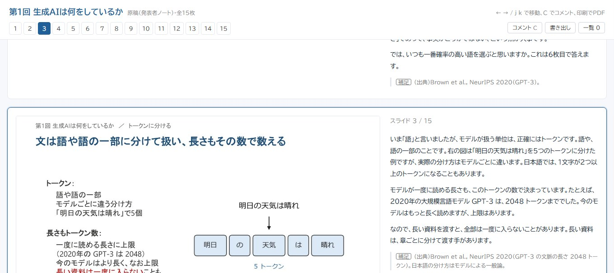 | 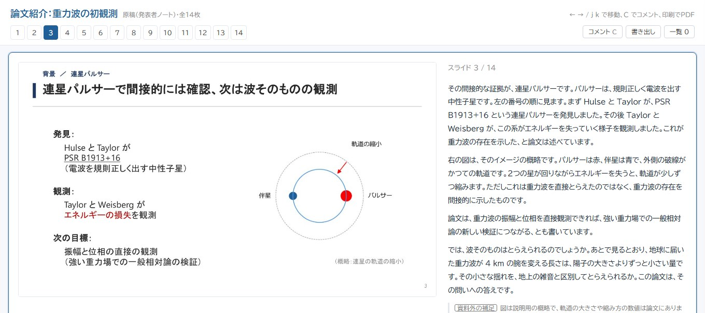 |
| 見本：AI活用講座 第1回「生成AIは何をしているか」全15枚 | 見本：論文紹介「重力波の初観測」（Abbott et al., PRL 2016、CC BY 3.0）全14枚 |

上の画像は、スライドといっしょに届く**原稿のページ**です。スライドと読み上げ原稿を横に並べて読め、疑問点のコメントや確認問題の答えもここに書きます。

<details>
<summary>講座の見本のスライドを全部見る（15枚）</summary>

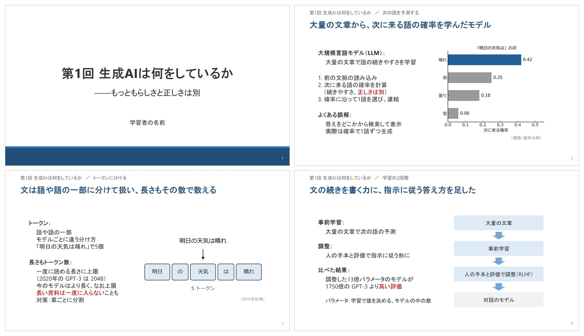
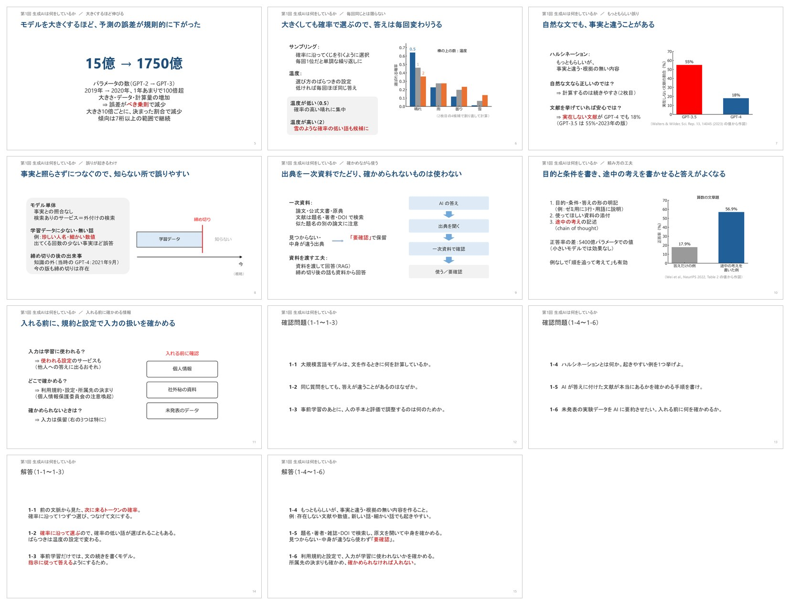
</details>

<details>
<summary>発表の見本のスライドを全部見る（14枚）</summary>

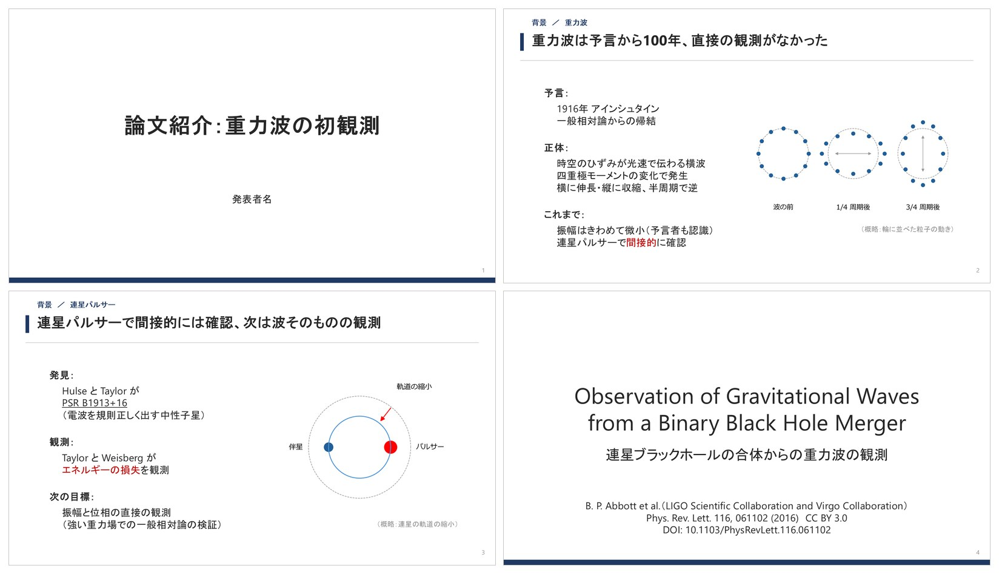
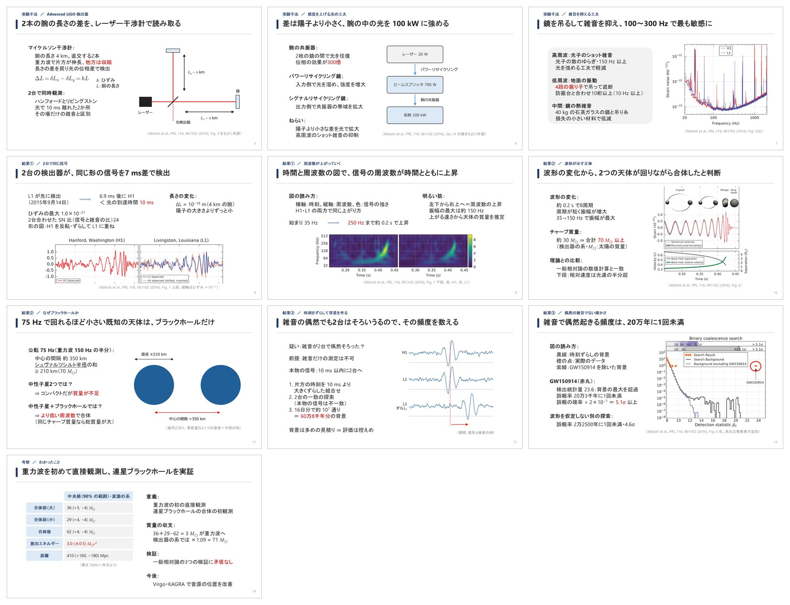

論文の図（Fig. 1・2・3・4）は、CC BY 3.0 の条件に従い、出典を付けて使っています（`examples/zemi/paper_figs/ATTRIBUTION.md`）。
</details>

どちらも、原稿のページで疑問点にコメントして渡すと、答えのデッキが届きます。
使い方の説明は **[スキルの使い方.html](スキルの使い方.html)** にあります（ダウンロードしてブラウザで開く。左上で講座か発表かを選びます）。

## このスキルが確かめること

AI にスライドを作らせると、見た目は整っていても「AI なら分かるが、人だと途中で止まる」資料になりがちです。このスキルは、作る前と作ったあとに、次の3つを確かめます。

### 1. 聞き手が止まる所を見つけて、流れの中で埋める（推論距離）

構成案（講座では各回の設計メモ）を、別の AI に聞き手の立場で読ませ、**聞き手が自分で補わないといけない前提を1つずつ文で書き出させます**。
AI は自分の知識で穴を埋めて「分かる」と言ってしまうため、「分かるか」ではなく「何を補ったか」を書かせます。

- 各前提に **要／深** を付けます。**要**は、その枚の結論の「なぜ・どうやって」が無い、知らない法則や用語が意味なしに出る、あとの枚・確認問題・回のゴールや話の筋で使う前提が抜けている、のどれか。**深**は、知らなくても分かるが知ると深まる話です
- この分け方は、実際の講座で学習者が付けたコメント（詰まった所・深めたかった所）に合わせて決めました。詰まった所はほぼ全部「要」に入り、深めたかった所は「深」に入ります
- **どこまで埋めるかは聞き手に合わせます。** 最初に、聞き手（講座なら学習者のあなた）がテーマに **初学者／多少知っている／かなり知っている** のどれかを必ず聞き、
  それで丁寧さが決まります。「その枚の結論の理由」と「意味の書いていない用語」はいつも埋め、「あとで使う前提」だけを、初学者なら全部・多少知っているなら1枚に1つまで残し・かなり知っているならもう少し残します。講座でもゼミでも同じで、回ごとに変えられます。
  任意で聞き手のプロフィール（専門・研究テーマ）を書くと、その人が知っていることは穴に数えず、知らない言葉はその人の分野の言葉で言い換えます。知らない用語は、どの聞き手でも必ず埋めます
- 埋め方は、説明のスライドを足すのではなく、前の枚で先に触れる・「理由は次で」と予告する・括弧で一言・原稿の1文、のように流れの中で済ませます。手当てが全部入ったかは機械で突き合わせます。深は数えず、講座なら原稿の補足の候補にします
- 書く側（構成案・原稿を書く AI）にも、同じ3つの型を最初から避けさせます

### 2. 文字の組み方まで設計する（本文の形）

1枚の中の文字を、ただの箇条書きにしません。「前提 ⇒ 帰結」「ラベル＋説明」「横の矢印で展開」「縦の矢印で結論へ」「場合分け」「問い → 答え」「手順」などの形を、構成案の「本文の形」の列で枚ごとに決め、部品で組みます。
並列カード・段違いの順序・循環・ツリー・前後・2つ並べた図などの図解の型もあります。渡す前の確認が、案どおりの部品で組んだかを突き合わせます。

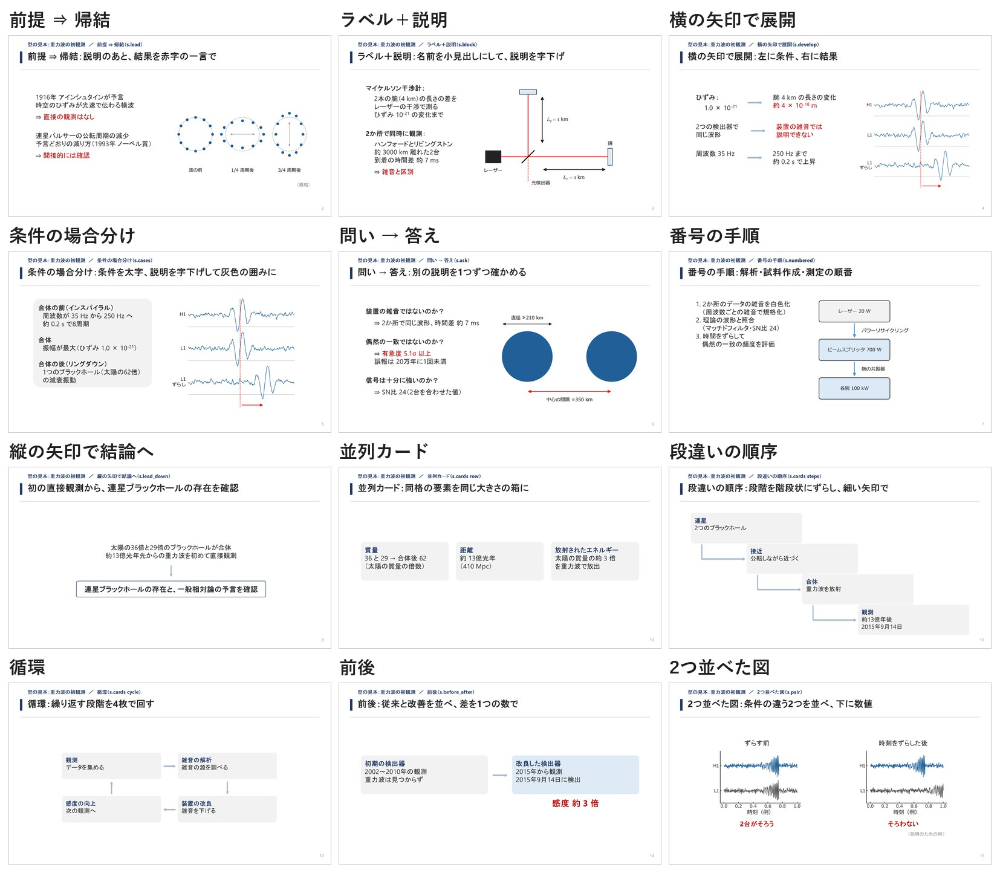

### 3. 量と強調を、描いた結果で確かめる

PowerPoint で実際に描いた位置で検査します。はみ出し・重なりだけでなく、
1枚の本文が **100〜150字** の目安に入っているか（少なすぎ・デッキ全体が薄い、も知らせる）、各枚に **赤字の結論** があるか、
講座の **確認問題が6問（1枚3問）** になっているか、1行の長さ・文章調・図との間隔まで見ます。

---

## 講座

講師の AI が、あなた専用の連続講座を作ります。テーマだけからでも、教科書・論文の PDF を土台にしても作れます。

```
テーマ or PDF → ヒアリング → 全体の地図（全N回）→ 第1回の設計メモ → スライドと原稿
     ↑                                                          ↓
  次の回の設計メモ ← つまずき一覧 ← 答えのデッキ ← コメントと確認問題の答え（原稿のページ）
```

**頼み方**：「生成 AI の使い方を一から教えて」「この教科書で全5回の講座を作って」「次の回を作って」「コメントした」

**工夫したところ**

- **事実の出どころを残す。** AI が講師だと、もっともらしい言い切りがそのまま講座に入ります。各回の設計メモに数値・式・定義の出典の表を作り、
  資料外のことは Web で裏を取り、取れないものは「要確認」と書きます。原稿にも「※（出典）」の行で残します。
  スライドを作る前に設計メモを機械で確かめます（本文が1回10〜15枚に入っているか、出典から資料を特定できるか）。
- **学習者の詳しさに合わせて、止まる所を埋める。** 最初のヒアリングで、テーマへの詳しさ（必須）と、任意で専門・研究テーマを聞き、各回の設計メモを「[聞き手が止まる所](#1-聞き手が止まる所を見つけて流れの中で埋める推論距離)」で確かめます。初学者なら要の穴は全部、流れの中で埋めます。確認問題は毎回6問（1枚に3問）です。
- **1回ずつ作る。** 前の回のコメントと確認問題の答えを読んでから次の回を作ります。取り違えた所は講座の「つまずき一覧」に残り、
  次の回の冒頭で補い、数回ごとに言い換えた問題で解き直します。
- **原稿は AI講義モード。** 「あなた」と呼びかけ、問いかけを入れ、学習者の専門の言葉に置き換えて説明します。確認問題には原稿のページの
  「1-1 に答える」ボタンで答え、答えのデッキで ○・△・× の添削が返ります。

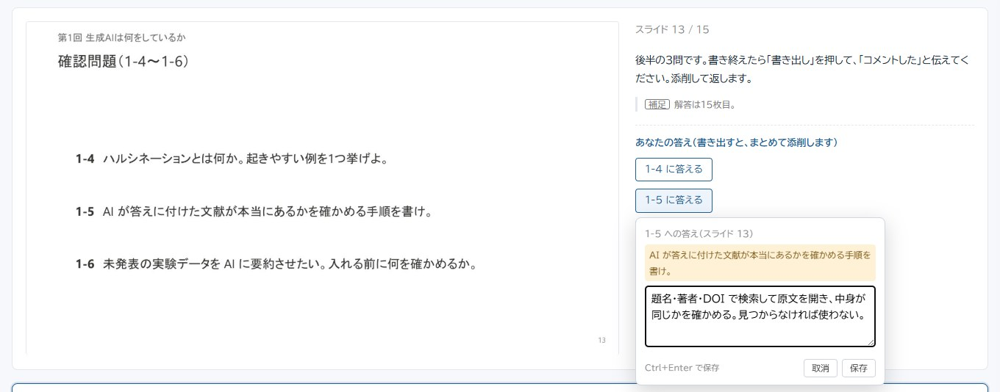

## 発表

1回の発表のスライドを作ります。研究室のゼミ（教科書の輪読・論文紹介）、学会・卒論発表などの研究発表、
発表の予定がなくても資料を人に説明できるところまで読み込む「ひとりゼミ」に使えます。

```
資料をフォルダに入れて頼む → 設定の確認（聞き手の詳しさ・発表時間）→ 資料を格納 → 構成案 → 構成案のレビュー → 図とスライド → 描画して検査 → 完成後のレビュー → 受け取る
```

**頼み方**：「教科書.pdf の 3.2 節をスライドにして」「論文紹介の発表資料を作って。論文は入れた」「学会の発表を作りたい。図と前のスライドを入れた」「この論文を自分の理解のためにまとめたい」

**資料の受け取り**：資料はフォルダの一番上に入れて頼みます。AI が中身を確かめてから、使うものを発表ごとのフォルダの `資料/` に、図・過去のスライド・その他（論文・教科書・メモ）に分けて写します（元のファイルは残ります）。
研究発表のように論文や原稿が全部はそろっていないときは、目的・各図で見えること・いちばん言いたい結論の3つのうち、ファイルに無いものをチャットで聞き、
聞いた言葉のまま `資料/方針.md` に書きます。背景と方法は、前のスライドや要旨から AI が下書きします。そろうまで構成案に進みません。結果と数値は、もらった資料からだけ取ります。

**工夫したところ**

- **結論の一文を先に決める。** 全スライドの「見出し・青帯の一文・図・要点」を表にしてから作り始めます。青帯の一文だけを上から読んで、
  節の話が通じるかを確かめます。
- **聞き手が詰まる所を埋める。** 上の「[聞き手が止まる所を見つけて、流れの中で埋める](#1-聞き手が止まる所を見つけて流れの中で埋める推論距離)」を構成案の段階でやります（「AI なら理解できるが人だと詰まる」と言われた論文紹介の反省から）。
  聞き手の詳しさで丁寧さが変わります（専門外の聞き手なら、多少知っている＝丁寧さ 1）。
- **枚数は構成案の段階で決める。** 本文の枚数を発表時間と比べ、少なすぎる（20分で10枚未満）ときは抜けている話がないかを見直させます。上限はゆるめです。
- **教科書のスキャンをそのまま読む。** 見開きのスキャン PDF を左右のページに分けて読み、教科書の図は話す所だけを切り出します。
  論文の図も、そのスライドで話すパネルだけを載せ、読み方の注記を重ねます。
- **読んだあとに理解を固める。** できた原稿を読んで疑問点にコメントすると、答えのデッキが届きます。発表で聞かれそうな所や、
  ひとりゼミで読み飛ばした所を先につぶせます。

---

## テンプレート

同梱のテンプレートは、**構造**（タイトルの置き方・結論の置き場・本文の場所と割合）の違う8つです。どれにも**標準の色**があり、**色はオプションで変えられます**（10の配色。どの構造にもどの色でも）。名前を言わなければ テンプレート1 を使います。テンプレートは番号のほか、構造の名前（「結論の囲み」など）でも選べます。
構造は、研究発表のデッキと、公開されているフリーのテンプレート（研究発表用・論文発表用）の形から、研究発表に合うものを選び、白紙から作りました。テンプレート1 は、ほかの7つの良い所（結論を先に・本文を最大に・飾りは短い縦棒と細い線だけ・濃い墨の文字）を合わせて作ったものです。

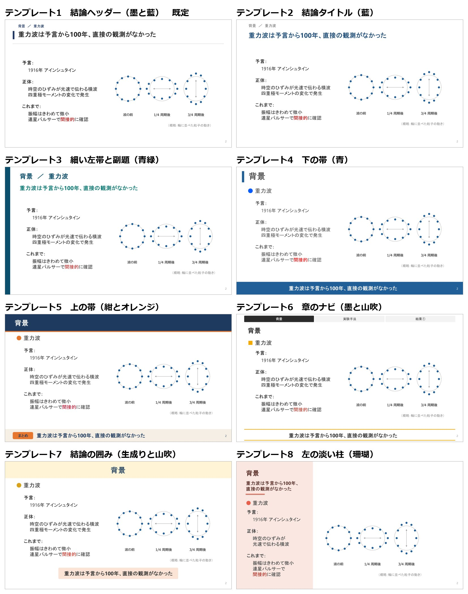

| 番号 | 構造 | 面積の割り振り | 標準の色 |
|---|---|---|---|
| テンプレート1（既定） | 結論ヘッダー：上に小さく話題と見出し、その下に大きく結論の一文（左に主色の短い縦棒）、細い線で本文と分ける。下の帯は無く、本文が一番広い | 上の2段 19%・本文 62%（一番広い） | 墨と藍 |
| テンプレート2 | 結論タイトル：上に小さく話題、その下に大きく結論の一文。下の帯は無し（結論を見出しにする形） | 上の2段 20%・本文 60% | 藍 |
| テンプレート3 | 細い左帯と副題：左端に主色の細い帯、大きなタイトルの下に結論の副題の1行。下の帯は無し | 左の帯 2%・上の2段 22%・本文 60% | 青緑 |
| テンプレート4 | 下の帯：左上の縦棒とタイトル、下の帯に結論の1行（ゼミの基本の形） | 本文 53%・下の帯 10% | 青 |
| テンプレート5 | 上の帯：上の濃い帯にタイトル、下に「まとめ」の札つきの淡い帯 | 上の帯 14%・本文 53%・下の帯 10% | 紺とオレンジ |
| テンプレート6 | 章のナビ：上に章の並び（今の章を主色に）、その下にタイトル、下に線で挟んだ結論の1行（長い発表） | 章のナビ 5%・本文 52%・下の線の帯 10% | 墨と山吹 |
| テンプレート7 | 結論の囲み：上に淡い帯（タイトルは中央）、下の帯は無く、結論は淡い色の囲みに（学会発表） | 上の帯 13%・本文 48%・結論の囲み 9% | 生成りと山吹 |
| テンプレート8 | 左の淡い柱：左の 34% の淡い柱にタイトル・結論・短い要点、右に図を大きく（図が主役の枚） | 柱 34%（タイトル・結論・短い要点）・右 60%（図） | 珊瑚 |

配色：青・紺とオレンジ・生成りと山吹・藍・青緑・珊瑚・墨と山吹・深緑・グレーと赤・墨と藍。同じ構造（上の帯）に配色を当てたもの：

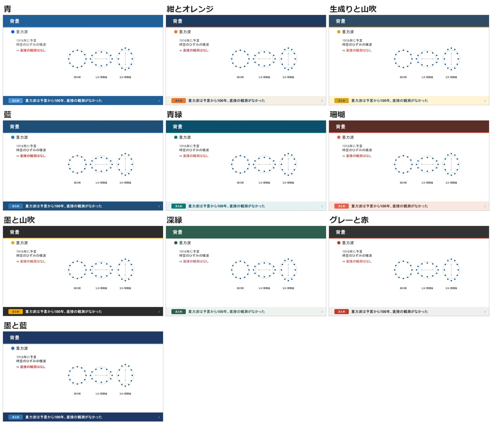

- **選ぶ**：頼むときに「テンプレートは テンプレート3 で、色は深緑」と言います（そのデッキの設定の一覧に入ります）。色を言わなければ、その構造の標準の色です。
- **手持ちのスライドから作る**：作業フォルダの `スライドテンプレート/` に置いて「このスライドからテンプレを作って」と頼むと、部品が元のスライドを約50項目分析し
  （大きさ・レイアウト・タイトルの位置と色・見出しの印・本文の大きさ・強調の色・下の帯・表の塗り・余白・図の置き方など。研究発表のデザインの手引きの目安も並べる）、
  テンプレートと見た目の設定（色・見出しの印・帯の寄せ）を作ります。AI の印象ではなく部品の表で作るので、どの AI で頼んでも同じ結果になります。
  AI が聞くのは、本文のレイアウト・まとめの帯・強調の色の3つだけです（`scripts/analyze_template.py`・`scripts/make_template.py`）。

同じ中身を テンプレート1（左）と テンプレート2（右）で組んだもの。中身（見出し・本文・図・まとめの一文）は同じで、テンプレートだけが違います（`examples/template/build.py`）。

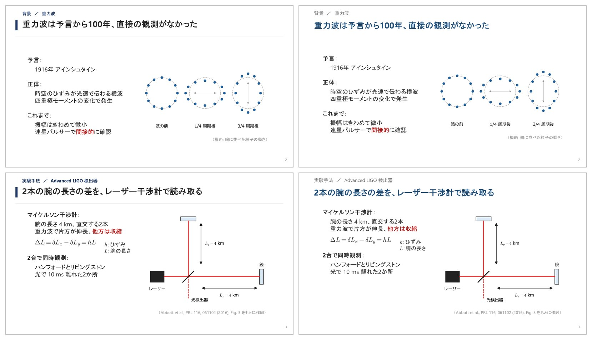

## 両方に共通する工夫

- **機械の検査を「合格」にしない。** PowerPoint で実際に描いた位置で、はみ出し・重なり・文字量・1行の長さ・文章調の行・本文と図の間隔を検査します。
  ERROR が 0 でも「文字が多い」「図との隙間がない」と言われたため、目安（1枚 100〜150字、1行 20字、図との間隔 0.4 in）に寄せるまでを仕上げにしました。多すぎだけでなく、少なすぎ・赤字の無い枚も知らせます。
- **最後まで手順を通したかを機械で確かめる。** 渡す前に、描画の検査・全スライドの原稿・原稿のページ・レビューの記録・出典・構成案の手当てがそろっているかを確かめ、そろうまで「できた」と言わせません。エージェントが部品を書き換えたり、代わりのスクリプト（自作の原稿ページ・別の描き方の図）を作ったりしていないかも、部品の指紋と作業フォルダの中身で見ます（ほかのエージェントで試したとき、PowerPoint が止められて代わりを自作したため）。
- **失敗を決まりに戻す。** 指摘を受けるたびに、原因を手順か検査に足しています（動詞で終わる行を見逃した → 検出を追加、
  OneDrive が古い版を開いた → 描画の前に一時フォルダへ複製、など）。
- **スライドの型を内容で選ぶ。** 左に文・右に図のほか、上に文・下に横長の図、全面の図、2つを並べて比べる、大きな数字・結論、表、流れ図、並列カード・段違いの順序・循環・ツリー・前後・2つ並べた図の型があります。同じ型が4枚を超えて続くと、渡す前の確認が知らせます。
- **文字の組み方も設計する。** 上の「[文字の組み方まで設計する](#2-文字の組み方まで設計する本文の形)」。手持ちのデッキから自分の組み方の割合を数え（`scripts/analyze_structure.py`）、その割合に寄せられます。型の辞書は `references/structures.md`。
- **作る前に環境を確かめる。** Python の部品・PowerPoint（無ければ LibreOffice）・日本語フォントを調べ、足りないものの入れ方を案内します（`scripts/check_env.py`）。
- **作る役とレビューする役、モデルを分ける。** 構成案と完成品を別のエージェントがレビューします。講座の設計と事実の裏取りは上位のモデル、
  スライド作りは標準のモデルでも可、完成後のレビューは上位のモデル、という分担を手順に書いてあります（ツールごとのモデルは対応表）。
- **設定はデッキごと、必須は抜かせない。** スキル全体の共通の設定ファイルは置かず、聞き手のテーマへの詳しさ（必須）・発表時間・テンプレートなどを、
  デッキごとの一覧（構成案の冒頭、講座は設計メモ）に書きます。必須が抜けていると検査が止めます。聞き手のプロフィール（専門・研究テーマ）は任意で、書くと言い換えと止まる所の判定がよくなります。

## 使われ方

これまでに **18 デッキ**をこのスキルで作りました（研究室のゼミ 3、自分用の講座 15。原稿のページも同じ数）。
講座は材料・データ解析・電子工学・SNS 運営など、全1〜7回のものを作りました（自分の論文を橋渡しに使った講座もあります）。

## フォルダ構成

| 場所 | 中身 |
|---|---|
| `SKILL.md` | スキル本体（AI が読む手順書）。入口の「発表か講座か」と、スライドを作る手順 |
| `references/course.md` | 講座の手順（ヒアリング・地図・設計メモ・レビュー・コメントから次の回へ） |
| `references/` | ほかに、書式ガイド・図のガイド・レビューの手順と雛形・構成案と図の実例と、ときどき使う流れ（質問回答デッキ `answer-deck.md`・続きもの `series.md`・テンプレートを作る `templates.md`） |
| `assets/` | スライドのテンプレート、講座の README と設計メモの雛形、配布の一式の はじめに.bat・.sh・.md（`assets/starter/`）、Codex の決まり（`assets/codex/`） |
| `scripts/` | `zemi.py`（スライドの部品）、`figkit.py`・`figlib.py`（図）、`check_layout.py`・`render_check.ps1`（描画検査）、`notes_html.py`（原稿のページ）、`comments_read.py`（コメントの読み込み）ほか |
| `examples/course/` | 講座の見本（AI活用講座：講座フォルダの README と、第1回の設計メモ・図・ビルド・原稿） |
| `examples/zemi/` | 発表の見本（論文紹介。構成案 → 図 → ビルド → 原稿） |
| `tests/` | テスト（文字の装飾の読み取り、設定の一覧と原稿の読み込み、レイアウト検査の判定、図の文字の検査、見本2つのビルドと原稿ページ、構成案と設計メモの確認、渡す前の確認） |
| `tools/` | 配る側の道具：配布の一式の zip を作る `make_starter.py`（一式には入らない） |

## 使い方

必要なもの：Python 3.10 以上と、AI エージェント（Codex・Claude Code・Antigravity・GitHub Copilot のどれか）。描画検査と原稿のページ作りには **Windows 版 PowerPoint** を使います。
PowerPoint が無いときは、無料の **LibreOffice** で代わりに描けます（Windows の見本3つでは検査の判定が PowerPoint と同じでした。やや甘めなので、最後は画像を目で確かめます。Mac・Linux ではまだ試していません）。図の日本語フォントは Meiryo / Yu Gothic を第一に、無ければヒラギノ・Noto Sans CJK を使います。

### 1. 一式をダウンロードして解凍する

スキルを入れ終わったスライド作業フォルダ **`sensei-slides.zip`** を解凍します。**[最新版をダウンロード](https://github.com/naito-kanato/sensei-slides/releases/latest/download/sensei-slides.zip)**（[Releases](https://github.com/naito-kanato/sensei-slides/releases) の一覧から、前の版も選べます。リポジトリからは `python tools/make_starter.py` で作れます）。
フォルダの名前は変えてかまいません（「発表」「講座」など）。中身はこうです。

```
スライド作業フォルダ/
  .agents/skills/sensei-slides/      スキル（Codex・Antigravity・VS Code の Copilot が読む）
  .claude/skills/sensei-slides/      同じスキル（Claude Code が読む）
  .codex/rules/sensei-slides.rules   Codex で PowerPoint を使う3つの作業だけを、確認なしで動かす決まり
  はじめに.bat / はじめに.sh / はじめに.md
```

### 2. はじめに.bat をダブルクリックする

仮想環境（`.venv`）を作って部品を入れ、PowerPoint やフォントがそろっているかを確かめます（数分、最初の1回だけ）。
Mac / Linux はターミナルで `sh はじめに.sh`。仮想環境にするのは、ほかの作業の Python の部品と版がぶつからないようにするためです。

### 3. フォルダをエージェントで開いて頼む

Codex・Claude Code・Antigravity・VS Code の Copilot でこのフォルダを開き、「〇〇の講座を作って」「〇〇.pdf のスライドを作って」と頼みます。
仮想環境を「有効」にしてから起動しなくてかまいません。スキルが、そのフォルダの `.venv` の Python を使います。
Codex では、そのフォルダを「信頼する」にします（`.codex/rules/` の決まりが読まれ、描画の検査・PDF の書き出し・原稿のページ作りの3つだけがサンドボックスの外で動きます）。
GitHub Copilot の CLI で使うときは、`.agents/skills/sensei-slides` を `.github/skills/sensei-slides` に写します。
スキルを新しくするときは、新しい一式の `.agents`・`.claude`・`.codex` で置き換えます（`_work/`・作ったスライドはそのまま）。

手順書は、特定のエージェントに頼らない中立の言葉（【上位モデル】【標準モデル】【質問】【別のエージェント】など）で書いてあります。
ツールごとに何に当たるかは、`references/agents.md` の**対応表**にまとめてあり、エージェントは最初にそれを読みます。
使うモデルを自分で決めたいときは、頼むときに言えば、対応表より優先されます。
Codex・Claude Code・Antigravity・GitHub Copilot CLI で、短いデッキ（講義メモから）や講座の1回（テーマだけから）を、手順書どおり最後まで（描画の検査・レビューの記録・原稿のページ・渡す前の確認まで）作れることを確かめています。
軽量のモデルは非推奨です。最後まで作れはしましたが、図の中身が薄く、資料にない仕組みを簡単にしすぎる所がありました。使うときは、図と事実の確認だけでも上位のモデルに頼むか、自分で確かめてください。

<details>
<summary>自分のフォルダにスキルだけ入れるとき</summary>

今あるフォルダで使うなら、このフォルダを、使うツールの場所に **`sensei-slides` という名前のまま**置きます。フォルダ名を変えると読み込まないツールがあります。

| ツール | 置く場所（プロジェクトの中） |
|---|---|
| Codex | `.agents/skills/sensei-slides/` |
| Claude Code | `.claude/skills/sensei-slides/` |
| Antigravity | `.agents/skills/sensei-slides/` |
| GitHub Copilot | `.github/skills/sensei-slides/`（VS Code なら `.agents/skills/` でも可） |

そのあと、スライドを作るフォルダで仮想環境を作って部品を入れます（`requirements.txt` の場所は、置いた場所に合わせる）。

```bat
python -m venv .venv
.venv\Scripts\python -m pip install -r .agents\skills\sensei-slides\requirements.txt
```

```bash
python3 -m venv .venv
.venv/bin/python -m pip install -r .agents/skills/sensei-slides/requirements.txt
```

`assets/starter/はじめに.bat` をそのフォルダに写してダブルクリックしても同じです。Codex で使うなら、`assets/codex/sensei-slides.rules` をそのフォルダの `.codex/rules/` に写します（全部のフォルダで使うなら `~/.codex/rules/`）。
仮想環境を使わずに、ふだんの Python に `pip install -r requirements.txt` で入れても動きます（`.venv` が無ければ、ふだんの Python を使います）。
</details>

エージェントがコマンドのたびに許可を求めてくるのが手間なら、`references/agents.md` の「許可リスト」にある行を、エージェントの設定の許可リストに登録します（`python` だけ、のような広い登録はしません）。

見本を動かすとき：

```bash
cd examples/zemi
python figs.py
python build.py
```

```bash
cd examples/course/_work/AI活用講座_01
python figs.py
python build.py
```

## トークンの使い方（費用の目安）

このスキルは、1デッキを作るあいだに、資料の読み込み・構成案・図の描き直し・描画の検査のやり直し・別のエージェントによるレビュー
（構成案と完成品の2回）を行うので、**トークンをまあまあ使います**。目安は次のくらいです。

| 作業 | 使ったトークン |
|---|---|
| レビュー担当（別のエージェント）1人分 | 約4万〜12.5万（資料の量による） |
| 同じ会話でレビュー担当を続投させた2回目 | 1回目の約3割 |
| 約50頁の論文をまるごと先読みさせたとき | 約18万 |

自分の使い方で何本作れるかは、ツールと時期で変わります。1デッキ作ったあとに、ツールの使用量の画面で割合を見て判断してください。下の工夫で使用量を減らせます。

- **スライドを組む役は【標準モデル】にする**。講座の設計と事実の確認・レビューだけを【上位モデル】にする（ツールごとのモデルは `references/agents.md` の対応表）
- **1回のデッキは本文10〜15枚くらいに収める**。長い資料は節や章で分けて、何回かに分ける
- **資料は使う章だけ読ませる**。教科書や論文をまるごと渡さない
- **続きものは同じ会話で作る**。レビュー担当を続投させると、2回目から大きく減る
- **構成案の確認は「任せる」にしない**。できたあとで構成から作り直すのが、いちばん高くつく
- **上限に近づいたら区切る**。作業フォルダ（`_work/`）に途中の状態が残るので、上限が戻ってから「続きを作って」と頼めば続けられる

## テスト

PowerPoint を使わない部分（100件。LibreOffice があれば、その描画も）は pytest で確かめられます。GitHub に push すると、GitHub Actions が Ubuntu と Windows で自動で走らせます。

```bash
pip install pytest
python -m pytest -q
```

PowerPoint で実際に描いて検査する部分（`render_check.ps1`）と、原稿ページの画像づくりはテストに含みません。見本を組んで描画検査を通すことで確かめています。

`scripts/` と `assets/` を直したら、`python tests/update_manifest.py` で部品の指紋（`scripts/MANIFEST.txt`）を作り直します。渡す前の確認が、エージェントが部品を書き換えていないかをこの指紋で見るためです（作り直し忘れはテストが見つけます）。

## 注意

- 手順書と検査のメッセージは日本語です。
- **論文や教科書の図を含むスライドについて**：研究室のゼミ（授業での利用）や自分の勉強（私的使用）のためのものです。スキルは切り出した図に出典を付けます。スライドや原稿のページ（スライドの画像が入っています）をネットに上げる・研究室の外に配る・学会や会社で使うときは、論文のライセンス（CC BY など）か出版社の許可を確かめてください。
- 発表の見本で紹介している論文（Abbott et al., *Phys. Rev. Lett.* **116**, 061102 (2016)）は CC BY 3.0 で公開されていて、図は出典を付けて使っています（`examples/zemi/paper_figs/ATTRIBUTION.md`）。

## ライセンス

[MIT](LICENSE)
